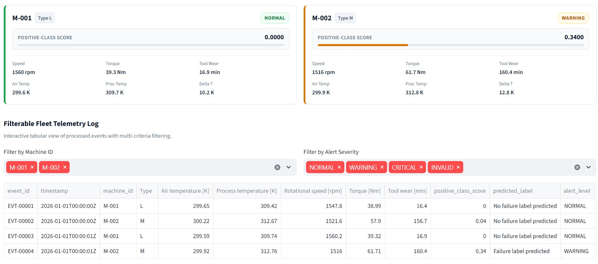
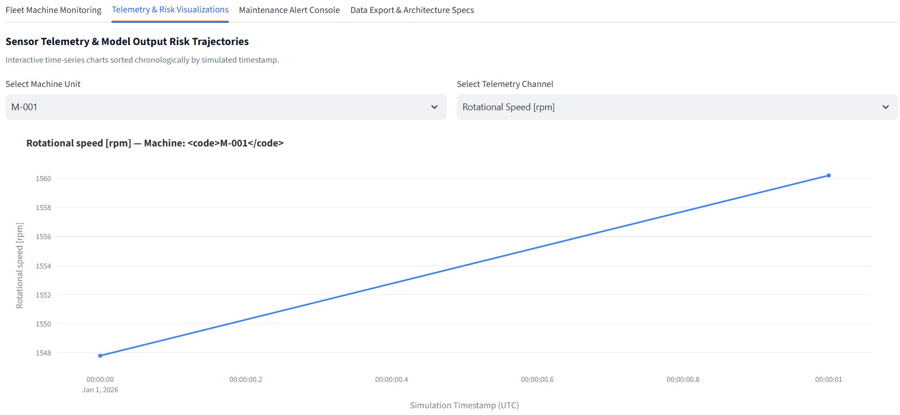
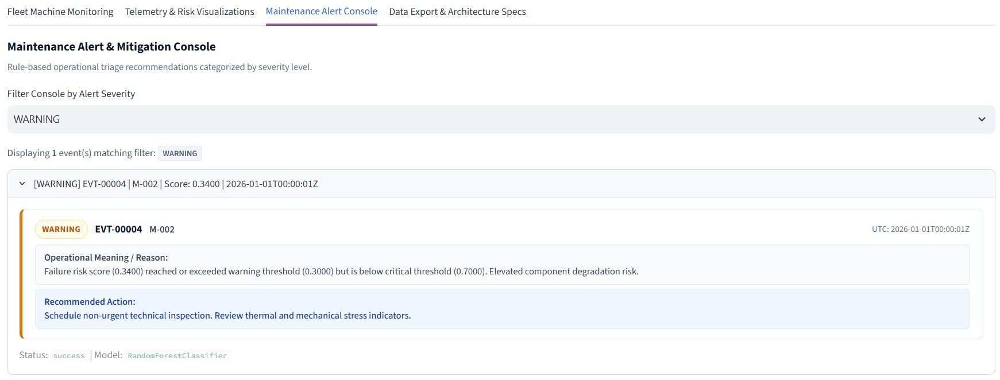
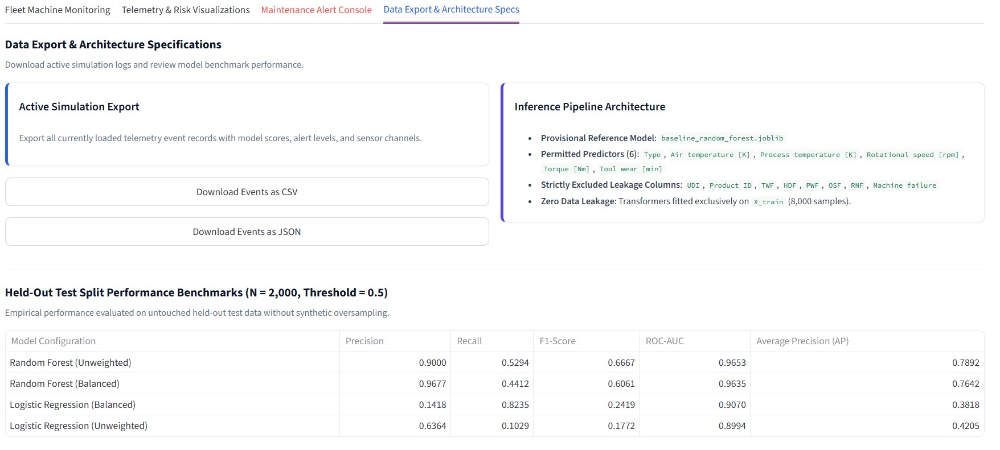

# AI-Powered Predictive Maintenance for IoT Devices

An end-to-end machine learning engineering and industrial IoT telemetry monitoring system for predictive equipment maintenance.

---

## Executive Summary

Unplanned industrial equipment downtime is one of the largest sources of operational loss in manufacturing, processing, and heavy industrial facilities. Traditional maintenance protocols follow rigid calendar-based inspection schedules that either replace functional components prematurely or fail to detect sudden, high-consequence in-service breakdowns.

This project delivers a data-driven predictive maintenance pipeline that analyzes multivariate industrial sensor telemetry in real time. By continuously evaluating mechanical, thermal, and cumulative wear signals, the system detects early indicators of operational degradation, generates calibrated risk indicators, and surfaces prioritized maintenance recommendations before functional failure occurs.

Key business benefits:
- Reduced Unplanned Downtime: Flags emerging component degradation before catastrophic failure occurs.
- Optimized Maintenance Scheduling: Shifts operations from reactive emergency shutdowns to planned, cost-effective maintenance windows.
- Actionable Operational Guidance: Translates raw machine learning model scores into structured triage recommendations (Normal, Warning, Critical).
- Methodological Rigor: Prevents data leakage by strictly separating training transformations from evaluation and production inference.

---

## System Architecture

The project is structured as a modular, test-driven Python package with clear separation of concerns across data ingestion, preprocessing, training, inference, alerting, simulation, and dashboard monitoring.

```
                          [ Industrial IoT Telemetry ]
                                       |
                                       v
                     +-----------------------------------+
                     | Data Loader & Schema Validation   |
                     | (data_loader.py)                  |
                     +-----------------------------------+
                                       |
                                       v
                     +-----------------------------------+
                     | Leak-Free Feature Preprocessor    |
                     | (preprocessing.py)                |
                     +-----------------------------------+
                                       |
                                       v
                     +-----------------------------------+
                     | ML Inference Engine               |
                     | (predict.py)                      |
                     +-----------------------------------+
                                       |
                                       v
                     +-----------------------------------+
                     | Rule-Based Alert Decision Engine  |
                     | (alert_system.py)                 |
                     +-----------------------------------+
                                       |
                     +-----------------+-----------------+
                     |                                   |
                     v                                   v
    +---------------------------------+ +---------------------------------+
    | CLI Automation Runner           | | Interactive Streamlit Dashboard |
    | (main.py)                       | | (app.py)                        |
    +---------------------------------+ +---------------------------------+
```

---

## Visual Interface and Architecture Overviews

The visual assets directory (`images/`) stores application screenshots and architectural diagrams:

### Fleet Machine Monitoring Deck

*Figure 1: Industrial IoT fleet monitoring interface displaying real-time KPI aggregates, per-machine status cards, sensor grids, and positive-class risk bars.*

### Sensor Telemetry and Risk Visualizations

*Figure 2: Chronologically ordered interactive sensor telemetry and model positive-class score trajectories with warning and critical threshold reference markers.*

### Maintenance Alert Console

*Figure 3: Actionable maintenance triage console categorizing events by severity level with operational explanations and approved safety guidance.*

### Model Evaluation Benchmarks

*Figure 4: Comparative evaluation of classification performance across tree ensembles and linear baselines on the held-out test split.*

### Data Export and Architecture Specifications

*Figure 5: Operational telemetry export tools and empirical validation metrics across evaluated model configurations.*

---

## Dataset and IoT Telemetry Channels

The system utilizes the **UCI AI4I 2020 Predictive Maintenance Dataset**, a synthetic benchmark reflecting real-world industrial milling operations.

### Approved Predictor Features (6 Channels)
The machine learning model is trained strictly on 6 non-leaking operational telemetry channels:
1. `Type`: Product quality variant (`L`, `M`, or `H`), reflecting tool stress tolerances.
2. `Air temperature [K]`: Ambient temperature surrounding the machinery.
3. `Process temperature [K]`: Internal operating temperature generated during machining.
4. `Rotational speed [rpm]`: Spindle rotation speed calculated from electrical power.
5. `Torque [Nm]`: Torque resistance exerted on the tool.
6. `Tool wear [min]`: Cumulative operational minutes elapsed on the cutting tool.

### Strictly Excluded Leakage Channels
To enforce strict data integrity and prevent target or identifier leakage:
- Identifiers: `UDI` and `Product ID` are dropped.
- Targets: `Machine failure` (ground truth label) is strictly excluded from features.
- Failure Mode Flags: `TWF` (Tool Wear Failure), `HDF` (Heat Dissipation Failure), `PWF` (Power Failure), `OSF` (Overstrain Failure), and `RNF` (Random Failure) are excluded from the feature matrix because they are recorded downstream of failure occurrence.

All data cleaning, numeric imputation, standard scaling, and categorical one-hot encoders are fitted exclusively on the training partition and frozen for all subsequent inference.

---

## Machine Learning Models and Evaluation Benchmarks

The project implements and evaluates four baseline classification pipelines on a held-out test split of 2,000 operational cycles (68 failure events, 1,932 nominal cycles; 3.4% failure prevalence):

| Model Configuration | Precision | Recall | F1-Score | ROC-AUC | Average Precision (AP) | True Positives | False Positives | True Negatives | False Negatives |
| :--- | :---: | :---: | :---: | :---: | :---: | :---: | :---: | :---: | :---: |
| **Random Forest (Unweighted)** | **0.9000** | 0.5294 | **0.6667** | **0.9653** | **0.7892** | 36 | 4 | 1928 | 32 |
| **Random Forest (Balanced)** | **0.9677** | 0.4412 | 0.6061 | 0.9635 | 0.7642 | 30 | **1** | **1931** | 38 |
| **Logistic Regression (Balanced)** | 0.1418 | **0.8235** | 0.2419 | 0.9070 | 0.3818 | **56** | 339 | 1593 | **12** |
| **Logistic Regression (Unweighted)** | 0.6364 | 0.1029 | 0.1772 | 0.8994 | 0.4205 | 7 | 4 | 1928 | 61 |

*Note on Metric Terminology: In imbalanced industrial failure classification, Average Precision (AP) evaluates the area under the precision-recall curve via weighted means of precisions. The unweighted Random Forest achieved the highest F1-score (0.6667) and highest Average Precision (0.7892), and serves as the provisional reference model (`models/baseline_random_forest.joblib`).*

---

## Maintenance Alert Decision System

Raw model outputs are mapped to actionable operational triage levels through a configurable rule-based alerting engine:

- **NORMAL (`score < 0.30`)**: Operating conditions within nominal boundaries. Standard operational monitoring continues.
- **WARNING (`0.30 <= score < 0.70`)**: Elevated thermal or mechanical stress detected. Non-urgent technical inspection recommended.
- **CRITICAL [Review] (`score >= 0.70`)**: High failure score detected. Prioritized technical inspection recommended.
- **INVALID (`Data Validation Fault`)**: Sensor reading missing, non-numeric, or physically impossible (e.g., negative rotational speed). Never defaults to normal.

Approved Critical Alert Guidance:
> "Prioritize maintenance review. Verify sensor readings and operating conditions, and follow the site's approved safety procedures before taking operational action."

---

## Interactive Monitoring Dashboard

The web dashboard (`app.py`) provides an industrial operator interface built with Streamlit and Plotly:
- KPI Monitoring Deck: Aggregated count of active events, normal cycles, warning alerts, critical review alerts, data errors, and fleet machines.
- Fleet Machine Overview: Real-time sensor state cards with status badges, tool wear indicators, torque readings, and model risk bars.
- Sensor Telemetry and Risk Visualizations: High-resolution Plotly time-series plots with configurable warning and critical threshold reference markers.
- Maintenance Alert Console: Operational triage console with filtering, root-cause explanations, and recommended maintenance actions.
- Data Ingestion and Simulation: On-demand simulation across operational regimes (`mixed`, `nominal`, `degradation`, `fault_injection`), custom CSV uploads with schema verification, and benchmark sample datasets.
- Data Export: Export active telemetry event streams to CSV or JSON.

---

## Repository Structure

```
AI-Powered Predictive Maintenance for IoT Devices/
|-- data/
|   |-- raw/                          # Raw dataset placeholder (Git-ignored)
|   |-- processed/                    # Processed data partitions (Git-ignored)
|   |-- sample_inference_records.csv  # 4-record benchmark sample (3 Normal, 1 Critical)
|   |-- sample_warning_records.csv    # 4-record demonstration sample (3 Normal, 1 Warning)
|   `-- README.md                     # Data acquisition and schema documentation
|-- src/                              # Core production source modules
|   |-- __init__.py
|   |-- data_loader.py                # Telemetry ingestion and schema validation
|   |-- preprocessing.py              # Cleaning, scaling, and missing value imputation
|   |-- feature_engineering.py        # Domain-inspired feature transformations
|   |-- train_model.py                # Model training and artifact serialization
|   |-- evaluate_model.py             # Performance metrics, ROC/PR curves, confusion matrices
|   |-- predict.py                    # Inference engine and schema validation
|   |-- alert_system.py               # Rule-based thresholding and alert routing
|   |-- simulator.py                  # Reproducible IoT sensor stream simulator
|   `-- dashboard_helpers.py          # Dashboard transformations and Plotly charts
|-- models/                           # Serialized model pipelines (Git-ignored)
|   `-- README.md                     # Model registry documentation
|-- outputs/                          # Generated runtime artifacts (Git-ignored)
|   |-- metrics/                      # JSON and CSV evaluation metrics
|   |-- predictions/                  # Batch prediction logs
|   `-- logs/                         # Execution logs
|-- images/                           # Visual documentation and screenshots
|   |-- architecture/                 # System architecture diagrams
|   |-- charts/                       # Evaluation curves and metric charts
|   |-- dashboard/                    # Dashboard UI screenshots
|   `-- README.md                     # Asset placement instructions
|-- docs/                             # Technical specifications and documentation
|   |-- 01_system_architecture.md
|   |-- 02_data_flow_and_pipeline.md
|   |-- 03_dataset_and_features.md
|   |-- 04_model_architecture_and_training.md
|   |-- 05_modules_and_components.md
|   |-- 06_validation_and_benchmarks.md
|   |-- 07_execution_log.md
|   |-- dataset_documentation.md
|   `-- model_card.md
|-- tests/                            # Automated test suite (121 tests)
|   |-- test_data_loader.py
|   |-- test_preprocessing.py
|   |-- test_train_model.py
|   |-- test_evaluate_model.py
|   |-- test_prediction.py
|   |-- test_alert_system.py
|   |-- test_simulator.py
|   `-- test_dashboard.py
|-- main.py                           # CLI entry point for workflow execution
|-- app.py                            # Streamlit dashboard entry point
|-- requirements.txt                  # Python dependencies
|-- .env.example                      # Environment configuration template
|-- .gitignore                        # Git exclusion rules
`-- README.md                         # Project documentation
```

---

## Installation and Setup

### Prerequisites
- Python 3.10 or higher
- Git

### Installation Steps

1. Clone or open the repository:
   ```bash
   cd "AI-Powered Predictive Maintenance for IoT Devices"
   ```

2. Create and activate a dedicated virtual environment:
   - On Windows (PowerShell):
     ```powershell
     python -m venv .venv
     .\.venv\Scripts\Activate.ps1
     ```
   - On Linux / macOS:
     ```bash
     python3 -m venv .venv
     source .venv/bin/activate
     ```

3. Install required dependencies:
   ```bash
   pip install --upgrade pip
   pip install -r requirements.txt
   ```

4. Configure local environment variables (optional):
   ```bash
   copy .env.example .env
   ```

---

## Execution Guide

### 1. Launch the Interactive Monitoring Dashboard
```bash
python -m streamlit run app.py
```
Open your browser at `http://localhost:8501`.

### 2. Command-Line Workflow Execution

Validate raw dataset integrity:
```bash
python main.py --mode validate
```

Preprocess raw dataset with train/test splitting:
```bash
python main.py --mode preprocess
```

Train all four baseline classification models:
```bash
python main.py --mode train
```

Evaluate all models on the held-out test split:
```bash
python main.py --mode evaluate
```

Run batch inference on raw telemetry records:
```bash
python main.py --mode predict --input data/sample_inference_records.csv
```

Evaluate rule-based maintenance alerts:
```bash
python main.py --mode alert --input data/sample_warning_records.csv
```

Run the IoT telemetry stream simulator:
```bash
python main.py --mode simulate --records 4 --machines 2 --scenario mixed --seed 3
```

---

## Automated Testing and Quality Verification

The repository includes a comprehensive automated test suite covering all modules:

```bash
pytest tests/ -v
```

Test coverage summary:
- `tests/test_data_loader.py`: Schema validation, null value detection, duplicate row handling (11 tests).
- `tests/test_preprocessing.py`: Feature separation, train-only transformation fitting, categorical encoding (11 tests).
- `tests/test_train_model.py`: Pipeline construction, reproducibility, forbidden feature exclusion (8 tests).
- `tests/test_evaluate_model.py`: Evaluation metrics, threshold analysis, confusion matrices (8 tests).
- `tests/test_prediction.py`: Schema validation, domain plausibility, batch ordering, immutability (22 tests).
- `tests/test_alert_system.py`: Threshold boundaries, invalid data handling, safety actions (19 tests).
- `tests/test_simulator.py`: Telemetry generation, seed reproducibility, fault injection (16 tests).
- `tests/test_dashboard.py`: KPI computation, filtering, Plotly figure generation, warning scenarios (25 tests).
- **Total:** **121 passed tests** with 0 failures.

---

## Research and Portfolio Disclaimers

1. Synthetic Data Source: The UCI AI4I 2020 predictive maintenance benchmark and simulator generate synthetic telemetry representing milling operations. Performance characteristics on real physical machines may differ.
2. No Live Machinery Connection: The system executes on software simulation and historical or uploaded CSV files. It does not connect to live plant machinery, industrial fieldbuses, or PLCs.
3. Cycle-Level Classification (No RUL): The model performs discrete single-cycle binary classification on individual telemetry records. It does not predict continuous degradation trajectories or Remaining Useful Life (RUL).
4. Positive-Class Score Interpretation: The model score represents the statistical positive-class output from the classifier. It is not a calibrated real-world failure probability or a direct sensor measurement of machine health.
5. Not a Certified Safety System: This prototype is for research, educational, and portfolio purposes. It must not be deployed as an autonomous safety-critical shutdown system without hardware interlocks and plant certifications.

---

## License

This project is distributed under the MIT License. Refer to `LICENSE` for terms and copyright details.
