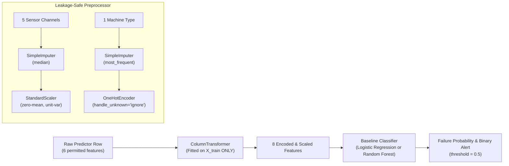

# 04. Model Architecture & Training Dynamics

---

## 1. Phase 4 Baseline Classification Objectives

The objective of Phase 4 is to establish rigorous, reproducible, leakage-aware baseline classification models on the UCI AI4I 2020 Predictive Maintenance benchmark. The primary binary target is `Machine failure` (0 = nominal operating cycle, 1 = machine failure event).

> [!IMPORTANT]
> **Research & Prototype Scope Limitation**: This phase establishes baseline classification performance on a synthetic industrial benchmark. It does not predict exact failure timing, remaining useful life (RUL), or physical failure dynamics in live industrial production. All reported figures represent preliminary baseline benchmarks.

---

## 2. Modeling Contract & Feature Selection

### Primary Prediction Target
* **`Machine failure`** (Binary: `0` for nominal operation, `1` for equipment failure). Verified strictly binary with 339 positive cases (3.39%) across 10,000 cycles.

### Permitted Baseline Predictors (6 Features)
The baseline models consume only the 6 raw physical and categorical sensor telemetry channels:
1. `Type` (Categorical: machine quality grade `L`, `M`, `H`)
2. `Air temperature [K]` (Continuous numeric: ambient temperature)
3. `Process temperature [K]` (Continuous numeric: internal process temperature)
4. `Rotational speed [rpm]` (Discrete/continuous numeric: spindle rotational velocity)
5. `Torque [Nm]` (Continuous numeric: spindle motor torque)
6. `Tool wear [min]` (Continuous integer: cumulative cutting tool usage duration)

### Strictly Excluded Columns (7 Features)
1. `UDI`: Row sequence index (causes artificial temporal/order overfitting).
2. `Product ID`: High-cardinality serial string (spurious memorization).
3. `TWF`, `HDF`, `PWF`, `OSF`, `RNF`: Post-hoc failure mode diagnostics. Including them creates catastrophic target leakage.

---

## 3. Preprocessing & Pipeline Architecture

Every model is instantiated as a self-contained scikit-learn `Pipeline` encapsulating the Phase 3 `ColumnTransformer` followed by the classifier estimator:



### Key Preprocessing Principles:
1. **Coupled Pipeline Serialization**: Model binaries encapsulate both `preprocessor` and `classifier`. A raw pandas DataFrame can be passed directly to `pipeline.predict()` without external manual feature scaling.
2. **Zero Leakage**: All imputers, scalers, and encoders are fitted strictly on `X_train`.
3. **No Resampling**: Resampling methods (SMOTE, ADASYN, random undersampling) are deliberately excluded in this baseline phase to establish an unadulterated baseline.

---

## 4. Four Baseline Model Configurations

Four configurations were implemented to evaluate the impact of non-linear decision boundaries and cost-sensitive class re-weighting under extreme imbalance (3.39% minority class):

### Configuration 1: Logistic Regression (Unweighted)
* **Identifier**: `logistic_regression`
* **Artifact**: `models/baseline_logistic_regression.joblib`
* **Formulation**: Standard L2-penalized logistic loss with equal sample weights ($w_0 = w_1 = 1.0$):
  $$\min_{w, c} \frac{1}{2} w^T w + C \sum_{i=1}^{n} \log\left(1 + \exp\left(-y_i (w^T x_i + c)\right)\right)$$
* **Hyperparameters**: `C=1.0`, `penalty='l2'`, `solver='lbfgs'`, `max_iter=2000`, `random_state=42`, `class_weight=None`.
* **Convergence Behavior**: Converged cleanly in under 50 iterations on scaled features with zero warnings.

### Configuration 2: Logistic Regression (Balanced)
* **Identifier**: `logistic_regression_balanced`
* **Artifact**: `models/baseline_logistic_regression_balanced.joblib`
* **Formulation**: L2-penalized logistic loss with cost-sensitive class weights inversely proportional to class frequencies:
  $$w_j = \frac{n}{2 \cdot n_j}$$
  For train set ($n=8000$, $n_0=7729$, $n_1=271$): $w_0 \approx 0.517$, $w_1 \approx 14.760$ (~28.5x higher penalty on false negatives).
* **Hyperparameters**: Same as Configuration 1 except `class_weight='balanced'`.

### Configuration 3: Random Forest (Unweighted)
* **Identifier**: `random_forest`
* **Artifact**: `models/baseline_random_forest.joblib`
* **Formulation**: Ensemble of 100 decorrelated classification decision trees built with bootstrap aggregation (bagging) and randomized feature subsets ($\sqrt{p} \approx 2.8$ features per split):
  $$\hat{p}(y=1|x) = \frac{1}{B} \sum_{b=1}^{B} T_b(x)$$
* **Split Criterion**: Gini impurity:
  $$G = 1 - \sum_{k \in \{0, 1\}} p_k^2$$
* **Hyperparameters**: `n_estimators=100`, `max_depth=None`, `min_samples_split=2`, `min_samples_leaf=1`, `random_state=42`, `class_weight=None`, `n_jobs=-1`.

### Configuration 4: Random Forest (Balanced)
* **Identifier**: `random_forest_balanced`
* **Artifact**: `models/baseline_random_forest_balanced.joblib`
* **Formulation**: Ensemble of 100 decision trees where bootstrap sample weights are dynamically adjusted inversely proportional to class frequencies within each bootstrap draw (`class_weight='balanced'`).
* **Hyperparameters**: Same as Configuration 3 except `class_weight='balanced'`.

---

## 5. Partitioning Strategy & Reproducibility

* **Source File**: `data/raw/ai4i2020.csv` (SHA-256: `dc6630cd9b1f0f853922fad78a1b6436570d3f1ec863f1dd5c4340ac56bc8a8e`)
* **Split Ratio**: 80% Training (8,000 records), 20% Test (2,000 records).
* **Random Seed**: `random_state=42` with `stratify=True` by `Machine failure`.
* **Class Distributions**:
  * **Training Split**: 7,729 nominal (`0`), 271 failures (`1`) $\rightarrow$ 3.3875% positive rate.
  * **Testing Split**: 1,932 nominal (`0`), 68 failures (`1`) $\rightarrow$ 3.4000% positive rate.
* **Held-out Isolation**: The test set was untouched during preprocessing fit, model training, and threshold tuning.

---

## 6. Serialized Model Artifacts

| Model Identifier | Model Name | Serialized File | Format | Steps Encapsulated |
| :--- | :--- | :--- | :--- | :--- |
| `logistic_regression` | Logistic Regression (Unweighted) | `models/baseline_logistic_regression.joblib` | Scikit-Learn Pipeline (`joblib`) | `preprocessor` + `classifier` |
| `logistic_regression_balanced` | Logistic Regression (Balanced) | `models/baseline_logistic_regression_balanced.joblib` | Scikit-Learn Pipeline (`joblib`) | `preprocessor` + `classifier` |
| `random_forest` | Random Forest (Unweighted) | `models/baseline_random_forest.joblib` | Scikit-Learn Pipeline (`joblib`) | `preprocessor` + `classifier` |
| `random_forest_balanced` | Random Forest (Balanced) | `models/baseline_random_forest_balanced.joblib` | Scikit-Learn Pipeline (`joblib`) | `preprocessor` + `classifier` |

---

## 7. Execution Commands

```bash
# Execute end-to-end model training and pipeline serialization
python main.py --mode train

# Execute test set evaluation and report generation
python main.py --mode evaluate
```
